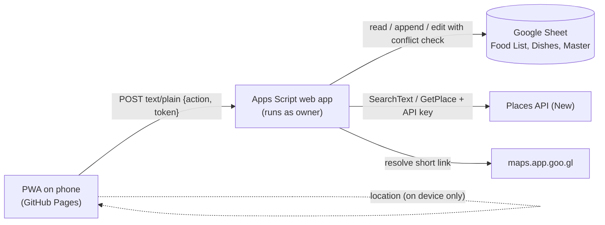

# Foodies Directory

Our personal directory of places to eat, on the phone. A Google Sheet is the database (same columns as the old "Foodies Checklist"); this app adds:

- **All / Wishlist / Near me** tabs: every place sorted by our scores, the places not tried yet, and everything sorted by distance from where you stand.
- **A full place record**: country, city, district, landmark, Tipe / Genre / Jenis, price, Google Maps and Instagram links, a score and a review from each of us.
- **Dishes per place**: what we ate, the price, liked or not, a note; starred dishes become the place's "Best Dish".
- **Add a place** by pasting a Google Maps link, sharing from Google Maps (Android), or typing a name. Google fills in the country, city, district, coordinates and Maps link. Places not on Google Maps can be added by name.
- **Edit everything from the phone**, with a check that refuses to overwrite a change made on the other phone or in the sheet.

Built for two people. Android: installs as an app with a home-screen icon. iPhone: works in Safari from the URL (home-screen icon optional). Free tools only.

## Repository Layout

| Path | What |
|---|---|
| `apps-script/` | Backend: Google Apps Script web app (sheet access, Places API, spend limits, backfill) |
| `web/` | Front end: installable web app (PWA) on GitHub Pages |
| `docs/decisions.md` | Architecture and design decisions |
| `docs/gcp-setup.md` | Google Cloud setup status |
| `CLAUDE.md`, `*/CLAUDE.md` | Rules and detailed maps for engineers and AI agents |

## Tech Stack & Constraints

- Google Sheets (database), Apps Script V8 (backend), Places API (New) — SearchText and GetPlace only.
- Vanilla HTML/CSS/JS PWA, no build step, hosted on GitHub Pages and published from `master` by a GitHub Actions workflow.
- Branches: `develop` is the base (default branch, all PRs); `master` is prod.
- `clasp` (root `package.json`) is the only dependency.
- The repo is public: secrets, IDs and URLs live in Script Properties or on each phone, never in git.

---

## Business Flow

### Find a place
1. Open the app → **All** shows the saved list at once, then refreshes from the sheet. Places are sorted by the average of both scores (ULTRA HEAVEN 🔥 > HEAVEN! > 10 … 1), unrated last.
2. **Wishlist** shows only places not tried yet. **Near me** asks for location and sorts by distance (with a "Wishlist only" switch). Location stays on the phone.
3. Search by name, city, dish or craving; **Filters** narrow by Tipe, Genre, Jenis or City. Closed places are hidden unless **Show closed places** is ticked.
4. Tap a card → the place: address, labels, both scores and reviews, price, best dish, dishes, **Maps** and **Instagram** buttons.

### Add a place
1. **Android:** in Google Maps, Share → Foodies. **iPhone or anywhere:** copy the Maps link, open **Add**, tap **Paste** (or long-press paste). Or type a name, e.g. "Bakmi GM Bandung".
2. Tap **Search** → up to 5 matches from Google → **Pick** the right one.
3. The place form opens, filled from Google (name, country, city, district, Maps link). Fix anything, add Tipe / Genre / Jenis (pick from the Master lists or **+ Add new…**), scores, reviews, price, Instagram → **Save**.
4. A row is appended to "Food List". If the place is already there, nothing is written and the app opens the existing one.
5. Not on Google Maps? **Add it by name** opens the same form without Google data.

### Update a place
- **Mark as tried / Move to wishlist** on the place, or **Edit** to change any field. Only changed fields are sent; if someone changed the same field on the other phone or in the sheet meanwhile, the save is refused with "Refresh and try again".
- **Dishes:** **+ Add dish** (name, price, 👍 / 👎, note, ⭐ best). Tap a dish to edit it; **Delete** asks for a second tap. Starring or unstarring rewrites the place's Best Dish.

### Install
- **Android (Chrome):** the **Install app** button in the top bar (or Chrome's menu → Install app).
- **iPhone (Safari):** works from the URL; Settings shows how to add a home-screen icon (Share → Add to Home Screen).

### Backfill old rows (owner, at migration)
Run `backfillBatch` in the Apps Script editor: 15 rows per run, resumable. Check the result in the sheet, then keep running until it logs 0 remaining. See `apps-script/CLAUDE.md` § 5.5.

---

## Data Flow

| Process | Entry point | Reads | Writes | Places calls |
|---|---|---|---|---|
| Load list | `list` → `listPlaces_` | Food List, Dishes, Master | `App ID` for rows typed in the sheet without one | 0 |
| Look up | `lookup` → `lookup_` | — | Script cache (10 min), `USAGE` | 1 |
| Add place | `add` → `addPlace_` | Food List, Master, script cache | Food List (append row), Master (new Tipe/Genre/Jenis) | 0–1 |
| Edit place | `update` → `updatePlace_` | Food List, Master | Changed Food List cells, UniqueName / Hyperlink, dish UniqueName, Master | 0 |
| Save dish | `saveDish` → `saveDish_` | Food List, Dishes | Dishes (append or edit row), place's Best Dish | 0 |
| Delete dish | `deleteDish` → `deleteDish_` | Dishes | Dishes (delete row), place's Best Dish | 0 |
| Backfill | `backfillBatch` (editor) | Food List | Empty app cells + `Lookup Status` | 1 per row |
| Set up | `setupSheet`, `checkColumns`, `addAppColumns` (editor) | Header rows | Header rows, Dishes and Master tabs | 0 |

**"Food List" user columns** (the old sheet's names): UniqueName, Nama Resto, Hyperlink, Negara, Kota, Lokasi, Jalan / Patokan, Rating (person 1), Rating (person 2), Range Harga (Per Orang), Tipe Foodies, Genre Foodies, Jenis Foodies, Best Dish, Review (person 1), Review (person 2), Link Instagram, Link Google, Closed, Have Tried?. The two names come from Script Property `PEOPLE`.
**App columns:** App ID, Place ID, Lat, Lng, Address, Google Category, Added At, Lookup Status.
**"Dishes":** Dish ID, App ID, UniqueName, Dish, Price, Liked, Best, Note, Added At. **"Master":** Ratings, Tipe Foodies, Genre Foodies, Jenis Foodies.

**Script Properties:** `PLACES_API_KEY`, `API_TOKEN`, `SPREADSHEET_ID`, `PEOPLE`, optional `DAILY_LIMIT` (50) / `MONTHLY_LIMIT` (900), and `USAGE` (written by code).
**On each phone (localStorage):** backend URL, token, last list (places, dishes, Master lists, names).

---

## Setup (once)

### Where the IDs and secrets live (never in git)

There is one environment (no dev copy): the Apps Script project in `.clasp-prod.json`, working on the spreadsheet in `SPREADSHEET_ID`. Work happens in a new spreadsheet; the old "Foodies Checklist" is migrated later.

| Value | Where | Committed? |
|---|---|---|
| Apps Script ID | `apps-script/.clasp-prod.json` → `scriptId` | No — gitignored; only `.clasp.example.json` is committed |
| Sheet ID | Script Property `SPREADSHEET_ID` | No — stored in Apps Script |
| Places API key, token | Script Properties `PLACES_API_KEY`, `API_TOKEN` | No |
| Web app `/exec` URL | Entered on each phone (Settings) | No |

Keep a copy of each in your password manager so a new laptop or phone can be set up again.

### Backend
1. `npm install` in the repo root, then `npx clasp login`.
2. Take a backup of the sheet if it holds data (File → Make a copy, or name a version in Version history). There is no dev copy, so everything below runs on live data.
3. In the Apps Script editor, Project Settings → IDs → copy the **Script ID**. Copy `apps-script/.clasp.example.json` to `apps-script/.clasp-prod.json` and paste the Script ID. The file is gitignored.
4. `npm run push-prod`. The push replaces every file in the project.
5. In the editor → Project Settings → Script Properties, add `PLACES_API_KEY`, `API_TOKEN` (32+ random characters, e.g. `node -e "console.log(require('crypto').randomBytes(32).toString('hex'))"`), `SPREADSHEET_ID` (from the sheet URL) and `PEOPLE` (the two names, comma-separated, as they should appear in the Rating / Review headers).
6. New, empty sheet: run `setupSheet` (writes the "Food List" headers, creates "Dishes" and "Master"), then fill the Master lists (Ratings in order worst → best, Tipe, Genre, Jenis). Sheet with data (migration): run `addAppColumns` instead.
7. Run `checkColumns` and confirm nothing is MISSING.
8. Deploy → New deployment → Web app, execute as **Me**, access **Anyone**. Copy the `/exec` URL to your password manager. Opening it in a browser only shows `{"ok":true}`; the app talks to it with POST.

### Front end
1. Push this repo to GitHub (public), both `develop` and `master`.
2. GitHub → Settings → General → Default branch → `develop`.
3. GitHub → Settings → Pages → Source: **GitHub Actions**.
4. GitHub → Settings → Environments → `github-pages` → Deployment branches: allow `master` (by default only the default branch, `develop`, may deploy).
5. Recommended: protect `develop` and `master` (Settings → Branches) so they change only through PRs.
6. Merge `develop` → `master`; the "Deploy web to GitHub Pages" workflow publishes `web/`.

### Deploy changes
- Backend: `npm run push-prod`, then Deploy → Manage deployments → edit the existing deployment → New version. The URL stays the same.
- Front end: PR `develop` → `master` and merge. The workflow deploys automatically.

## Install on the phones

- **Android (Chrome):** open the GitHub Pages URL → tap **Install app** in the top bar (or Chrome menu → Install app). Open it, enter the backend URL and token in Settings. "Foodies" now appears in the Share menu of Google Maps.
- **iPhone (Safari):** open the URL and enter the backend URL and token; everything works in Safari. Optional: Share → **Add to Home Screen** for an icon. To add a place, copy the Maps link and use **Paste** in Add.

## Keeping This README Current

Business Flow and Data Flow describe the code as it is now. Any change to what the user sees, which data moves where, a column, a Script Property or a deploy step updates this file in the same commit (see `CLAUDE.md` § 4).
