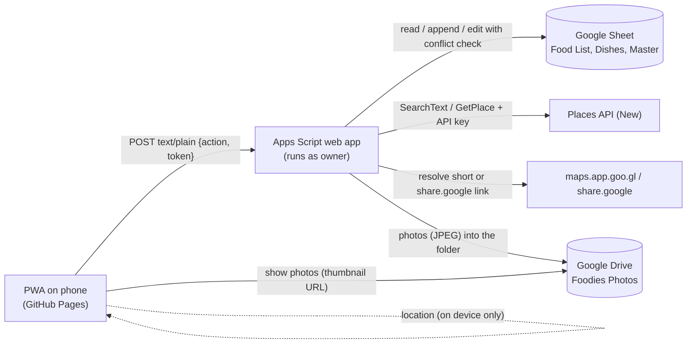

# Foodies Directory

Our personal directory of places to eat, on the phone. A Google Sheet is the database (same columns as the old "Foodies Checklist"); this app adds:

- **All / Wishlist / Near me** tabs: every place sorted by our scores, the places not tried yet, and everything sorted by distance from where you stand.
- **A full place record**: country, city, district, landmark, Type / Genre / Category, price, Google Maps and Instagram links, a score and a review from each of us.
- **Dishes per place**: what we ate, the price, liked or not, a note; starred dishes become the place's "Best Dish".
- **Add a place** by pasting a Google Maps or share.google link, sharing from Google Maps (Android), or typing a name. Google fills in the country, city, district, coordinates and Maps link. Places not on Google Maps can be added by name.
- **Labels**: any number of your own tags per place ("Date night", "Trip Tokyo", "Halal"), to filter the lists.
- **Photos**: up to 5 of our own per place and per dish, from the camera or the library; the first one is the card's cover.
- **Copy and share**: a place's name, location and Google Maps link, ready to paste into a chat; or a whole filtered list at once.
- **Edit everything from the phone**, with a check that refuses to overwrite a change made on the other phone or in the sheet.

Built for two people. Android: installs as an app with a home-screen icon. iPhone: works in Safari from the URL (home-screen icon optional). Free tools only.

## Repository Layout

| Path | What |
|---|---|
| `apps-script/` | Backend: Google Apps Script web app (sheet access, Places API, spend limits, backfill) |
| `web/` | Front end: installable web app (PWA) on GitHub Pages |
| `api/`, `frontend/` | New stack being built (Django on Cloud Run, React PWA on Firebase Hosting); not live yet |
| `docker-compose.yml`, `firebase.json` | Local dev containers for the new stack; Firebase Hosting config |
| `docs/decisions.md` | Architecture and design decisions |
| `docs/gcp-setup.md` | Google Cloud setup status |
| `CLAUDE.md`, `*/CLAUDE.md` | Rules and detailed maps for engineers and AI agents |

## Tech Stack & Constraints

- Google Sheets (database), Apps Script V8 (backend), Places API (New) — SearchText and GetPlace only, Google Drive for photos.
- Vanilla HTML/CSS/JS PWA, no build step, hosted on GitHub Pages and published by a GitHub Actions workflow: `master` at the site root (live), `develop` under `/test/` (test).
- Branches: `develop` is the default branch and the test environment: work is committed to it directly, and every push publishes the test copy. `master` is prod (merging publishes the live app). A release is a PR `develop` → `master`.
- `clasp` (root `package.json`) is the only dependency.
- The repo is public: secrets, IDs and URLs live in Script Properties or on each phone, never in git.

---

## Business Flow

### Find a place
1. Open the app → **All** shows the saved list at once, then refreshes from the sheet. Places are sorted by the average of both scores (ULTRA HEAVEN 🔥 > HEAVEN! > 10 … 1), unrated last.
2. **Wishlist** shows only places not tried yet. **Near me** asks for location and sorts by distance (with a "Wishlist only" switch). Location stays on the phone.
3. Search by name, city, dish, label or craving. Tap **label chips** above the list to show only places with all the chosen labels. **Filters** narrow by Type, Genre, Category or City. Closed places are hidden unless **Show closed places** is ticked.
4. Tap a card → the place: address, labels, both scores and reviews, price, best dish, dishes, **Maps** and **Instagram** buttons.

### Copy and share
- The **⧉** button on a card, or **Copy** on the place, copies three lines: name, location (landmark, district, city, country) and the Google Maps link.
- **Share** on the place opens the phone's share menu (WhatsApp, LINE…) with the same text.
- **Copy list** copies every place currently shown (after search, labels and filters), separated by a blank line.

### Add a place
1. **Android:** in Google Maps, Share → Foodies. **iPhone or anywhere:** copy the Maps link, open **Add**, tap **Paste** (or long-press paste). Or type a name, e.g. "Bakmi GM Bandung". A share.google link (from Google's Share button) works too: the app takes the place name it carries and searches for it.
2. Tap **Search** → up to 5 matches from Google → **Pick** the right one.
3. The place form opens, filled from Google (name, country, city, district, Maps link). Fix anything, add Type / Genre / Category (pick from the Master lists or **+ Add new…**), scores, reviews, price, Instagram → **Save**. Country, City and District suggest values already used on other places. Google's names and addresses come in English, so a city is spelled one way.
4. A row is appended to "Food List". If the place is already there, nothing is written and the app opens the existing one.
5. Not on Google Maps? **Add it by name** opens the same form without Google data.

### Update a place
- **Mark as tried / Move to wishlist** on the place, or **Edit** to change any field. **Labels:** tap a label to remove it, type a new one and tap **Add**, or tap a suggested label used on other places. Only changed fields are sent; if someone changed the same field on the other phone or in the sheet meanwhile, the save is refused with "Refresh and try again".
- **Dishes:** **+ Add dish** (name, price, 👍 / 👎, note, ⭐ best). Tap a dish to edit it; **Delete** asks for a second tap. Starring or unstarring rewrites the place's Best Dish.

### Photos
- On a place, **Photos** shows how many it has, with **View photos** and **+ Add photo**. **+ Add photo** opens the phone's camera or photo library; several pictures can be picked at once. On a dish, **+ Add photo** appears once the dish is saved.
- Up to 5 photos per place and 5 per dish. The phone shrinks each picture to JPEG (longest side 1600 px) before uploading it.
- **View photos** shows the place's photos, then each dish's. Tap one for full screen; **Remove** asks for a second tap. Back closes the viewer.
- The first photo of a place is its cover on the list; a place without photos shows the first photo of one of its dishes.
- Photos are stored in Google Drive, in a folder called "Foodies Photos - <sheet name>", and each is shared with anyone who has its link. A removed photo goes to Drive's trash (kept 30 days).
- Photos load from Google Drive, so they need a connection; they are not kept for offline use.

### Install
- **Android (Chrome):** the **Install app** button in the top bar (or Chrome's menu → Install app).
- **iPhone (Safari):** works from the URL; Settings shows how to add a home-screen icon (Share → Add to Home Screen).

### Settings
- **⚙** in the top bar opens Settings: the backend URL and token, **Theme** (System follows the phone; Light or Dark), and on iPhone a hint to add the app to the home screen. The theme is chosen per phone.

### Backfill old rows (owner, at migration)
Run `backfillBatch` in the Apps Script editor: 15 rows per run, resumable. Check the result in the sheet, then keep running until it logs 0 remaining. See `apps-script/CLAUDE.md` § 5.5.

---

## Data Flow



| Process | Entry point | Reads | Writes | Places calls |
|---|---|---|---|---|
| Load list | `list` → `listPlaces_` | Food List, Dishes, Master | `App ID` for rows typed in the sheet without one | 0 |
| Look up | `lookup` → `lookup_` | — | Script cache (10 min), `USAGE` | 1 (a share.google link is followed by Apps Script first) |
| Add place | `add` → `addPlace_` | Food List, Master, script cache | Food List (append row), Master (new Type/Genre/Category) | 0–1 |
| Edit place | `update` → `updatePlace_` | Food List, Master | Changed Food List cells, UniqueName / Hyperlink, dish UniqueName, Master | 0 |
| Save dish | `saveDish` → `saveDish_` | Food List, Dishes | Dishes (append or edit row), place's Best Dish | 0 |
| Delete dish | `deleteDish` → `deleteDish_` | Dishes | Dishes (delete row), place's Best Dish, the dish's photos to Drive trash | 0 |
| Add photo | `addPhoto` → `addPhoto_` | Food List or Dishes (`Photos` cell) | Drive folder (new JPEG, shared by link), `Photos` cell | 0 |
| Delete photo | `deletePhoto` → `deletePhoto_` | Food List or Dishes (`Photos` cell) | `Photos` cell; Drive file to trash | 0 |
| Backfill | `backfillBatch` (editor) | Food List | Empty app cells + `Lookup Status` | 1 per row |
| Set up | `setupSheet`, `checkColumns`, `addMissingColumns`, `setupPhotos` (editor) | Header rows | Header rows, Dishes and Master tabs; `setupPhotos` creates the Drive folder and `PHOTO_FOLDER_ID` | 0 |

**"Food List" user columns** (English since D51; `renameHeadersToEnglish` converts the old Indonesian names): UniqueName, Name, Hyperlink, Country, City, District, Landmark, Rating (person 1), Rating (person 2), Price Range (Per Person), Type, Genre, Category, Labels (comma-separated), Best Dish, Review (person 1), Review (person 2), Instagram Link, Google Maps Link, Closed, Have Tried?. The two names come from Script Property `PEOPLE`.
**App columns:** App ID, Place ID, Lat, Lng, Address, Google Category, Added At, Lookup Status, Photos (Drive file IDs, comma-separated; the first is the cover).
**"Dishes":** Dish ID, App ID, UniqueName, Dish, Price, Liked, Best, Note, Added At, Photos (same format). **"Master":** Ratings, Type, Genre, Category.

**Script Properties:** `PLACES_API_KEY`, `API_TOKEN`, `SPREADSHEET_ID`, `PEOPLE`, `PHOTO_FOLDER_ID` (written by `setupPhotos`), optional `DAILY_LIMIT` (50) / `MONTHLY_LIMIT` (900), and `USAGE` (written by code).
**On each phone (localStorage):** backend URL, token, last list (places, dishes, Master lists, names), theme (`foodies.theme`). The test copy keeps its own URL, token and list under `foodies-test.*` keys; the theme is shared.
Prod and test each have their own Script Properties, spreadsheet, photo folder and Places usage counter.

---

## Setup (once)

### Where the IDs and secrets live (never in git)

There are two environments. **Prod** is the Apps Script project in `.clasp-prod.json`, working on the live spreadsheet in its `SPREADSHEET_ID`. **Test** is a second Apps Script project in `.clasp-test.json`, bound to a copy of that spreadsheet (see Test environment below). Work happens in a new spreadsheet; the old "Foodies Checklist" is migrated later.

| Value | Where | Committed? |
|---|---|---|
| Apps Script ID (prod, test) | `apps-script/.clasp-prod.json`, `apps-script/.clasp-test.json` → `scriptId` | No — gitignored; only `.clasp.example.json` is committed |
| Sheet ID (prod, test) | Script Property `SPREADSHEET_ID` of each project | No — stored in Apps Script |
| Places API key, token (each project has its own token) | Script Properties `PLACES_API_KEY`, `API_TOKEN` | No |
| Drive photo folder ID (prod, test) | Script Property `PHOTO_FOLDER_ID` of each project (written by `setupPhotos`) | No |
| Web app `/exec` URLs (prod, test) | Entered on each phone (Settings) | No |

Keep a copy of each in your password manager so a new laptop or phone can be set up again.

### Backend
1. `npm install` in the repo root, then `npx clasp login`.
2. Take a backup of the sheet if it holds data (File → Make a copy, or name a version in Version history). Steps 3–8 run on the live project and sheet.
3. In the Apps Script editor, Project Settings → IDs → copy the **Script ID**. Copy `apps-script/.clasp.example.json` to `apps-script/.clasp-prod.json` and paste the Script ID. The file is gitignored.
4. `npm run push-prod`. The push replaces every file in the project.
5. In the editor → Project Settings → Script Properties, add `PLACES_API_KEY`, `API_TOKEN` (32+ random characters, e.g. `node -e "console.log(require('crypto').randomBytes(32).toString('hex'))"`), `SPREADSHEET_ID` (from the sheet URL) and `PEOPLE` (the two names, comma-separated, as they should appear in the Rating / Review headers).
6. New, empty sheet: run `setupSheet` (writes the "Food List" headers, including Photos, and creates "Dishes" and "Master"), then fill the Master lists (Ratings in order worst → best, Type, Genre, Category). Sheet with data (a new column such as Labels or Photos, or migration): run `addMissingColumns` instead (it covers "Food List" and "Dishes").
7. Run `checkColumns` and confirm nothing is MISSING. Then run `setupPhotos` once and approve the Drive access it asks for; it creates the "Foodies Photos - <sheet name>" folder and stores `PHOTO_FOLDER_ID`. Photos do not work before this.
8. Deploy → New deployment → Web app, execute as **Me**, access **Anyone**. Copy the `/exec` URL to your password manager. Opening it in a browser only shows `{"ok":true}`; the app talks to it with POST.

### Front end
1. Push this repo to GitHub (public), with `master` and `develop` branches.
2. GitHub → Settings → General → Default branch → `develop`.
3. GitHub → Settings → Pages → Source: **GitHub Actions**.
4. GitHub → Settings → Environments → `github-pages` → Deployment branches: allow exactly `develop` and `master`.
5. Protect `master` (Settings → Branches): PR required (0 approvals), applies to admins, no force push or delete. `develop` stays open for direct commits.
6. A push or merge into `develop` publishes the test copy under `/test/`; merging into `master` publishes the live app at the site root. Either push rebuilds the whole site from both branches, and the "Deploy web to GitHub Pages" workflow runs.
   Caveat: until the workflow is on `master` (the first release after it), a push to `master` runs the old workflow, which drops `/test/`.

### Test environment (once)
1. Live spreadsheet → File → Make a copy → name it "Foodies Directory TEST". The copy holds the data and the bound script.
2. In the copy: Extensions → Apps Script → Project Settings → Script ID. Copy `apps-script/.clasp.example.json` to `apps-script/.clasp-test.json` and paste the ID (gitignored).
3. In the test project's Script Properties, set `SPREADSHEET_ID` (the copy's ID), a new `API_TOKEN`, `PEOPLE` (same as prod), `PLACES_API_KEY` (same key as prod), `DAILY_LIMIT` = 10 and `MONTHLY_LIMIT` = 100. Each project counts spend separately, so the combined ceiling is prod + test. Whether a copied spreadsheet carries Script Properties is **Unverified**, so set them all.
4. `npm run push-test`. In the test editor run `setupSheet` only if the copy is empty; otherwise run `addMissingColumns`, then `checkColumns`. Then run `setupPhotos` and approve the Drive access (it creates the test sheet's own photo folder).
5. Deploy → New deployment → Web app, execute as **Me**, access **Anyone**. Keep the test `/exec` URL in the password manager.
6. On each phone, open `https://<user>.github.io/foodies-directory/test/`, then enter the test URL and token in Settings. The yellow "Foodies TEST" bar shows you are on the test copy.

### Deploy changes
- Backend: test first, then prod. `npm run push-test`, then Deploy → Manage deployments → edit the existing test deployment → New version. For a release, `npm run push-prod`, then the same on the live deployment. The URLs stay the same.
- First release with photos, in each project (test first, then prod): push; editor `addMissingColumns` (until it runs, `list` and the dish actions fail with "Missing columns … Photos"); editor `setupPhotos` and approve the Drive access; update that deployment to a new version. The manifest declares explicit OAuth scopes, so the first editor run may ask to authorize again.
- Front end: commit and push to `develop` (or merge a PR into it); the test site updates under `/test/`. Release by opening a PR from `develop` into `master` and merging it; the live site updates.
- English headers (one-time, D51), in each project (test first, then prod): push, run `renameHeadersToEnglish` in the editor, run `checkColumns`, then update that deployment to a new version right away. Then push the front end (`develop` for test; release PR for live).
- Day to day: work on `develop`. If the change touches `apps-script/`, run `npm run push-test` and update the test deployment → push `develop` (test site updates) → try it on both phones. Release: take a backup, `npm run push-prod`, update the live deployment, then PR `develop` → `master` and merge (live site updates).

## Local development (new stack, Docker only)

The replatform (`docs/decisions.md` D39–D63) runs entirely in containers, so the machine only needs Docker. In WSL (Ubuntu), once:

```bash
sudo apt update && sudo apt install -y docker.io docker-compose-v2
sudo usermod -aG docker $USER   # then close and reopen the WSL terminal
```

Then, from the repo root:

| Task | Command |
|---|---|
| Start database, API and web | `docker compose up` → http://localhost:5173 (API on http://localhost:8000); the API applies migrations on every start, so a wiped database gets its tables back |
| API tests | `docker compose run --rm api python manage.py test` |
| Front-end type-check + build | `docker compose run --rm web npm run build` |
| Try the built app (service worker, install) | `docker compose run -d --rm --name foodies-preview -p 127.0.0.1:4173:4173 web npx vite preview --host 0.0.0.0 --port 4173` → http://localhost:4173; stop with `docker stop foodies-preview` |
| Create / apply database migrations | `docker compose run --rm api python manage.py makemigrations` / `… migrate` |
| Admin site (table view of all data) | `docker compose run --rm api python manage.py createsuperuser` once, then http://localhost:8000/api/admin/ |
| Import the sheet (CSV exports of Food List, Dishes, Master in `api/`) | `docker compose run --rm api python manage.py import_sheet --people "Name1,Name2" --places food-list.csv --dishes dishes.csv --master master.csv` (add `--dry-run` to check first) |
| Sample data to build screens against (empty local database only) | `docker compose run --rm api python manage.py seed_sample` |
| Sign in locally (no Google sign-in in Docker) | `docker compose run --rm api python manage.py dev_token` (add `--person 2` for the second person), then paste the printed token into **Local dev token** on http://localhost:5173 |
| Stop / wipe the local database | `docker compose down` / `docker compose down -v` (then `docker compose up -d` recreates the tables; refill with `seed_sample` or `import_sheet`) |

### Restore a backup (new stack)

The nightly job (`docs/decisions.md` D63) saves `foodies-<date>-<time>.dump` plus a `.sha256` file to the private backup bucket of each environment, kept 30 days. From the repo root, with `gcloud` signed in:

| Task | Command |
|---|---|
| List backups | `gcloud storage ls gs://<project>-backups/` |
| Download one (with its fingerprint) | `gcloud storage cp "gs://<project>-backups/foodies-2026-11-24-0200.dump*" .` |
| Check the download is identical (also after copying it to Drive and back) | `sha256sum -c foodies-2026-11-24-0200.dump.sha256` → `foodies-2026-11-24-0200.dump: OK` |
| Check it reads back | `docker compose run --rm --no-deps -v "$PWD:/backup" api pg_restore --list /backup/foodies-2026-11-24-0200.dump` (a table list; `TABLE DATA public places` must be in it) |
| Restore into the local database (replaces its data) | `docker compose run --rm -v "$PWD:/backup" api sh -c 'pg_restore --clean --if-exists --no-owner --dbname "$DATABASE_URL" /backup/foodies-2026-11-24-0200.dump'` |

To restore the cloud database: create a new Neon branch or project, run the same `pg_restore` with its **direct** (non-pooler) connection string, check it, then point the `DATABASE_URL` secret at it and redeploy. Neon itself can also roll back the last 6 hours (free plan). Dump files hold all the data: keep downloaded copies private, never in the repo (`*.dump` is gitignored).

Cloud setup (projects, Neon, keys) is done in the browser and in Google Cloud Shell, which already has `gcloud`, so nothing is installed locally for it either. Deploys run in GitHub Actions and stay off until the repository variable `CLOUD_DEPLOY` is set to `on`.

## Install on the phones

- **Android (Chrome):** open the GitHub Pages URL → tap **Install app** in the top bar (or Chrome menu → Install app). Open it, enter the backend URL and token in Settings. "Foodies" now appears in the Share menu of Google Maps.
- **iPhone (Safari):** open the URL and enter the backend URL and token; everything works in Safari. Optional: Share → **Add to Home Screen** for an icon. To add a place, copy the Maps or share.google link and use **Paste** in Add.
- **Test copy:** `https://<user>.github.io/foodies-directory/test/` is a separate app with its own settings (test URL and token), storage and cache. It is installed and used separately from the live app: on Android, Install app from the test page; on iPhone, Add to Home Screen from the test page. Use it to try changes before they go live.

## Keeping This README Current

Business Flow and Data Flow describe the code as it is now. Any change to what the user sees, which data moves where, a column, a Script Property or a deploy step updates this file in the same commit (see `CLAUDE.md` § 4).
