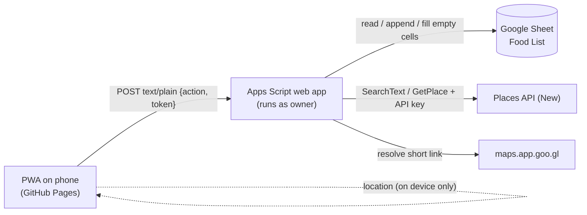

# Foodies Directory

Our restaurant list on the phone. The Google Sheet "Foodies Checklist" stays the database; this app adds:

- **Near me** — sort every place by distance from where you stand.
- **Filter by craving and city**, and show only places not tried yet.
- **Add a place** by pasting a Google Maps link, sharing from Google Maps (Android), or typing a name. Google fills in the address, coordinates, category and Maps link.
- **Backfill** of the ~230 existing rows with the same Google data, without touching anything already typed in the sheet.

Built for two people, Android first, iPhone too. Free tools only.

## Repository Layout

| Path | What |
|---|---|
| `apps-script/` | Backend: Google Apps Script web app (sheet access, Places API, spend limits, backfill) |
| `web/` | Front end: installable web app (PWA) on GitHub Pages |
| `docs/decisions.md` | Architecture and design decisions |
| `docs/gcp-setup.md` | Google Cloud setup status |
| `CLAUDE.md`, `*/CLAUDE.md` | Rules and detailed maps for engineers and AI agents |

## Tech Stack & Constraints

- Google Sheets (database), Apps Script V8 (backend), Places API (New) — SearchText and GetPlace only.
- Vanilla HTML/CSS/JS PWA, no build step, hosted on GitHub Pages and published from `master` by a GitHub Actions workflow.
- Branches: `develop` is the base (default branch, all PRs); `master` is prod.
- `clasp` (root `package.json`) is the only dependency.
- The repo is public: secrets, IDs and URLs live in Script Properties or on each phone, never in git.

---

## Business Flow

### Find a place
1. Open the app → **Places** shows the cached list at once, then refreshes from the sheet.
2. Type in search, pick a **craving** (Google category or your Tipe/Genre/Jenis labels) or a **city**, tick **Not tried yet** (shown when the sheet has a tried column).
3. Tap **Near me** → the phone asks for location → the list is sorted by distance. Location stays on the phone.
4. Tap **Maps** on a card to open it in Google Maps.

### Add a place
1. **Android:** in Google Maps, Share → Foodies. **iPhone or anywhere:** copy the Maps link, open **Add**, tap **Paste**. Or type a name, e.g. "Bakmi GM Bandung".
2. Tap **Look up** → up to 5 matches from Google.
3. Optionally fill your labels (Tipe, Genre, Jenis), then **Save** on the right match.
4. A new row is appended to "Food List". If the place is already there, nothing is written and the app says so.

### Backfill old rows (owner, once)
Run `backfillBatch` in the Apps Script editor: 15 rows per run, resumable. Check the result in the sheet, then keep running until it logs 0 remaining. See `apps-script/CLAUDE.md` § 5.5.

---

## Data Flow

| Process | Entry point | Reads | Writes | Places calls |
|---|---|---|---|---|
| Load list | `list` → `listPlaces_` | Food List | — | 0 |
| Look up | `lookup` → `lookup_` | — | Script cache (10 min), `USAGE` | 1 |
| Save | `add` → `addPlace_` | Food List, script cache | Food List (append row) | 0–1 |
| Backfill | `backfillBatch` (editor) | Food List | Empty app cells + `Lookup Status` | 1 per row |
| Set up | `checkColumns`, `addAppColumns` (editor) | Header row | Header row (append app headers) | 0 |

**App-owned columns** (appended by `addAppColumns`): Place ID, Lat, Lng, Address, Area, Google Category, Google Maps URL, Lookup Status.
**User columns** read by header name (unverified names, see `apps-script/src/Config.js`): Name, Link, City, Tipe, Genre, Jenis, HEAVEN, Price, Tried.

**Script Properties:** `PLACES_API_KEY`, `API_TOKEN`, `SPREADSHEET_ID`, optional `DAILY_LIMIT` (50) / `MONTHLY_LIMIT` (900), and `USAGE` (written by code).
**On each phone (localStorage):** backend URL, token, last list.

---

## Setup (once)

### Where the IDs and secrets live (never in git)

| Value | Dev | Prod | Committed? |
|---|---|---|---|
| Apps Script ID | `apps-script/.clasp-dev.json` → `scriptId` | `apps-script/.clasp-prod.json` → `scriptId` | No — gitignored; only `.clasp.example.json` is committed |
| Sheet ID | Script Property `SPREADSHEET_ID` in the dev script | Script Property `SPREADSHEET_ID` in the prod script | No — stored in Apps Script |
| Places API key, token | Script Properties `PLACES_API_KEY`, `API_TOKEN` | same, in the prod script | No |
| Web app `/exec` URL | Entered on the phone (Settings) | Entered on the phone (Settings) | No |

Keep a copy of each in your password manager so a new laptop or phone can be set up again.

### Backend
1. `npm install` in the repo root, then `npx clasp login`.
2. Make a **dev copy** of the sheet (File → Make a copy). Steps 3–8 run against the copy first, then again for prod.
3. Create a standalone Apps Script project (script.google.com → New project), one for dev and later one for prod. Copy `apps-script/.clasp.example.json` to `apps-script/.clasp-dev.json` (and `.clasp-prod.json`) and paste each Script ID. These files are gitignored.
4. `npm run push-dev`.
5. In the editor → Project Settings → Script Properties, add `PLACES_API_KEY`, `API_TOKEN` (generate 32+ random characters in your password manager) and `SPREADSHEET_ID` (from the sheet URL).
6. Run `checkColumns`, read the log, fix `USER_FIELDS` in `apps-script/src/Config.js` to match the real headers, push again.
7. Run `addAppColumns`. Run `backfillBatch` once and check the 15 rows.
8. Deploy → New deployment → Web app, execute as **Me**, access **Anyone**. Copy the `/exec` URL to your password manager.

### Front end
1. Push this repo to GitHub (public), both `develop` and `master`.
2. GitHub → Settings → General → Default branch → `develop`.
3. GitHub → Settings → Pages → Source: **GitHub Actions**.
4. GitHub → Settings → Environments → `github-pages` → Deployment branches: allow `master` (by default only the default branch, `develop`, may deploy).
5. Recommended: protect `develop` and `master` (Settings → Branches) so they change only through PRs.
6. Merge `develop` → `master`; the "Deploy web to GitHub Pages" workflow publishes `web/`.

### Deploy changes
- Backend: `npm run push-dev` (or `push-prod`), then Deploy → Manage deployments → edit the existing deployment → New version. The URL stays the same.
- Front end: PR `develop` → `master` and merge. The workflow deploys automatically.

## Install on the phones

- **Android (Chrome):** open the GitHub Pages URL → menu → **Install app** (or Add to Home screen). Open it, enter the backend URL and token in Settings. "Foodies" now appears in the Share menu of Google Maps.
- **iPhone (Safari):** open the URL → Share → **Add to Home Screen**. Open it from the home screen, enter the backend URL and token. To add a place, copy the Maps link and use **Paste** in Add.

## Keeping This README Current

Business Flow and Data Flow describe the code as it is now. Any change to what the user sees, which data moves where, a column, a Script Property or a deploy step updates this file in the same commit (see `CLAUDE.md` § 4).
